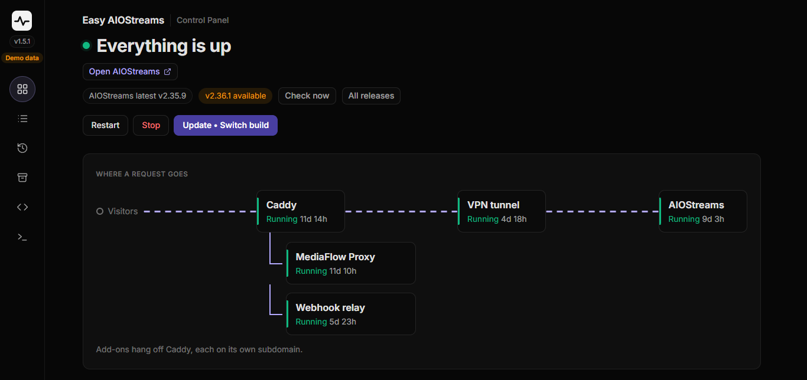

# Easy AIOStreams

[](./LICENSE)

A one-command installer for a self-hosted [AIOStreams](https://github.com/Viren070/AIOStreams) instance. It sets up Docker, Caddy (automatic HTTPS via Let's Encrypt), and secure login access to the config page and dashboard, all in one script. Restricted to your own credentials.

> [!NOTE]
> **Opinionated by design.** The script owns the whole stack on a fresh VPS: Docker, Caddy, the compose file and the services. It's made for people who want one thing that works end to end, and it won't slot into an existing reverse proxy or compose setup. If you already have one you like, you probably don't need this. It's one bash script, so you can read exactly what it sets up before you run it.

> [!IMPORTANT]
> **Installed this before October 2026?** The install folder has moved from `/root/aiostreams` to `/opt/aiostreams`, and these scripts only work with the new location. [Follow these steps to move your install](https://github.com/alpinezx/easy-aiostreams/tree/migrate-to-opt) (about a minute of downtime, with a backup first).
>
> **Installing for the first time?** You can skip this.

## Contents

- [What this gives you](#what-this-gives-you)
- [Prerequisites](#prerequisites)
- [Quick start](#quick-start)
- [Re-running the script later](#re-running-the-script-later)
- [Backup & Restore](#backup--restore-migrating-to-a-new-server-optional)
- [Troubleshooting](#troubleshooting)
- [Other Scripts](#other-scripts)

## What this gives you

- Your own AIOStreams instance, not a shared public one
- HTTPS out of the box, auto-renewing, no manual cert wrangling
- **App-level login** (AIOStreams' own auth). The configure page, dashboard, and the config API all require your username/password, so nobody else can create or edit configs on your instance.
- A management menu for status, restart, updates, backups, and clean uninstall
- Single-tarball backup and restore for migrating to a new server, plus optional scheduled backups
- **An optional web control panel (beta)** to manage everything from your browser or phone instead of over SSH. → [Control panel guide](./docs/basic/control-panel.md)



<sub>The control panel's demo mode, with every add-on running. Your own panel shows only what you've installed.</sub>

## Prerequisites

- A fresh VPS with root access, running Ubuntu 24.04+ or Debian 13 (should also work on Debian 12, untested)
- Ports 80 and 443 opened in your provider's firewall if it's enabled. Oracle cloud users, do this first > [Firewall Ports](./docs/basic/firewall-ports.md#2-check-your-providers-own-firewall-separate-from-the-server).
- A subdomain you control, with an **A record already pointed at your server's IP** before running the script

<details>
<summary><b>Don't have a VPS yet?</b></summary>

Any provider with root SSH access works: DigitalOcean, Hetzner, Oracle's free tier, Vultr, and others all run this fine. Compare specs and pricing at [vpsbenchmarks.com's under-$8/month list](https://www.vpsbenchmarks.com/best_vps/2026/under/8).

**This script won't run on Vercel, Netlify, Railway, or similar app-hosting platforms.**

</details>

<details>
<summary><b>Don't have a domain yet?</b></summary>

Any registrar works. If you're buying one just for this, prefer `.xyz` or `.top` over a country-code TLD (`.co.uk`, `.de`). They're usually DNS-ready in minutes, versus hours to days for country-code domains.

- **[Porkbun](https://porkbun.com)**: cheap `.xyz`/`.top`, free WHOIS privacy + SSL, near-instant activation
- **[Spaceship](https://spaceship.com)**: Namecheap's leaner sister site, competitive pricing (especially `.com`), free WHOIS privacy
- **[Namecheap](https://namecheap.com)**: the established option, huge TLD selection, slightly pricier renewals
- **[DuckDNS](https://www.duckdns.org)**: totally free `yourname.duckdns.org` subdomain, no card needed. Fine for personal use, though you don't get to pick your own TLD.

</details>

## Quick start

### Confirm your DNS is actually pointing at your server first

Swap `yourdomain.xyz` for your own real domain, it's just a placeholder. Use the bare name only, no `https://`, no trailing `/`. For a subdomain, use `dig +short aio.yourdomain.xyz`. It should print a single IP; compare it to your server's:

```bash
dig +short yourdomain.xyz
```

```bash
curl -4 ifconfig.me
```

Don't run the installer until these two lines match.

<details>
<summary><b>What a match and a mismatch look like</b></summary>

**✅ Example: Matches, good to go:**
```
dig +short yourdomain.xyz
192.0.2.15
curl -4 ifconfig.me
192.0.2.15
```

**❌ Example: Doesn't match yet, wait and retry:**
```
dig +short yourdomain.xyz
198.51.100.23
curl -4 ifconfig.me
192.0.2.15
```
Different IPs mean the domain isn't pointing at this server yet.

</details>

### Run the installer

Create the install folder and move into it:

```bash
sudo mkdir -p /opt/aiostreams && cd /opt/aiostreams
```

Download the script:

```bash
sudo curl -fsSL https://raw.githubusercontent.com/alpinezx/easy-aiostreams/refs/heads/main/setup-aiostreams.sh -o setup-aiostreams.sh
```

(Optional: take a look before running it with `less setup-aiostreams.sh`)

Run it:

```bash
sudo bash setup-aiostreams.sh
```

It asks for your domain, a login, and which build to run. Once it finishes, visit your domain and log in. From there, AIOStreams' own setup takes over.

## Re-running the script later

Run it again any time with `sudo bash /opt/aiostreams/setup-aiostreams.sh` and it'll detect your existing install and offer a menu that loops back after each action:

```
 1) View status
 2) Stop AIOStreams
 3) Start AIOStreams
 4) Restart the stack (AIOStreams + Caddy, and the VPN if enabled)
 5) Update (pull latest images + restart; can also switch stable/nightly)
 6) Reconfigure (change domain/login, backs up your current config first)
 7) Backup (one tarball with everything needed for migration or safekeeping)
 8) Restore from backup (also runs on a fresh server: sudo bash setup-aiostreams.sh restore <file>)
 9) Uninstall (clean removal)
10) Exit
11) Maintenance (free up space, system updates, container log limits)
```

## Backup & Restore (Migrating to a new server, optional)

Back up your whole stack to a single tarball and restore it to your existing or a new VPS, preserving the same domain, login, `SECRET_KEY`, and all, so every existing user config and installed Stremio manifest keeps working. Covers the DNS update you'll need afterward if you're migrating to a new server. → [Basic](./docs/basic/backup-restore.md) · [Advanced](./docs/advanced/backup-restore.md)

## Troubleshooting

**HTTPS certificate stuck at "not confirmed"?** [Firewall & Ports Guide](./docs/basic/firewall-ports.md#2-check-your-providers-own-firewall-separate-from-the-server)

Addon/scraper blocked, streams failing to load, `403`/`429`/`502` errors in the logs? [Add-on Proxy Setup](./docs/basic/addon-proxy-setup.md)

The most common issues you may come across: [Common Issues](./docs/troubleshooting.md#most-likely-issues)

Links to every guide (basic and advanced): [All Guides](./docs/troubleshooting.md#all-guides)

If you suspect it's not your setup at all, check [Stremio Status](https://status.stremio-status.com/) or [IbbyLabs Uptime Tracker](https://uptime.ibbylabs.dev/) to see if the addon/provider itself is down.

## Other Scripts

Want your own private [AIOMetadata](./docs/basic/aiometadata.md) for catalogs and metadata, a web control panel (beta), a system-wide VPN layer, phone alerts when your server needs you, a way to turn a third-party site's webhook into a phone alert, or a lighter alternative proxy if scrubbing/seeking spikes your VPS's CPU? Those live in their own standalone scripts, see [Other Scripts](./docs/other-scripts.md)

For bugs in the script itself: [open an issue](https://github.com/alpinezx/easy-aiostreams/issues). For setup questions not covered here or in the linked guides, check out these Reddit threads: [r/StremioAddons](https://www.reddit.com/r/StremioAddons/comments/1vo6a5q/self_hosted_aiostreams_easy_install_script/), [r/nuvioaddons](https://www.reddit.com/r/nuvioaddons/comments/1vsud3b/self_hosted_aiostreams_easy_install_script_nuvio/)

## License

MIT, see [LICENSE](./LICENSE). Provided as-is, no warranty; you're responsible for your own server, keys, and data.
