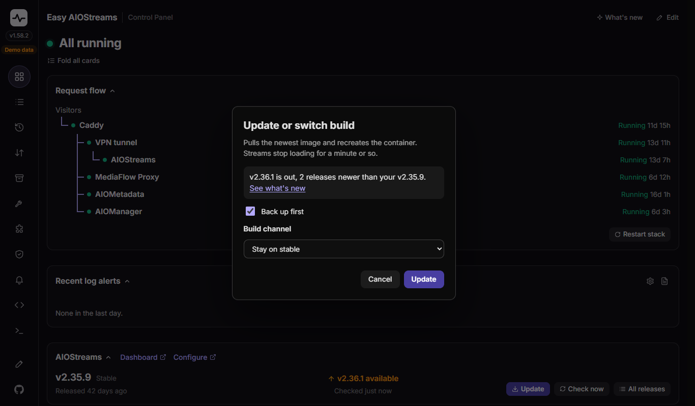
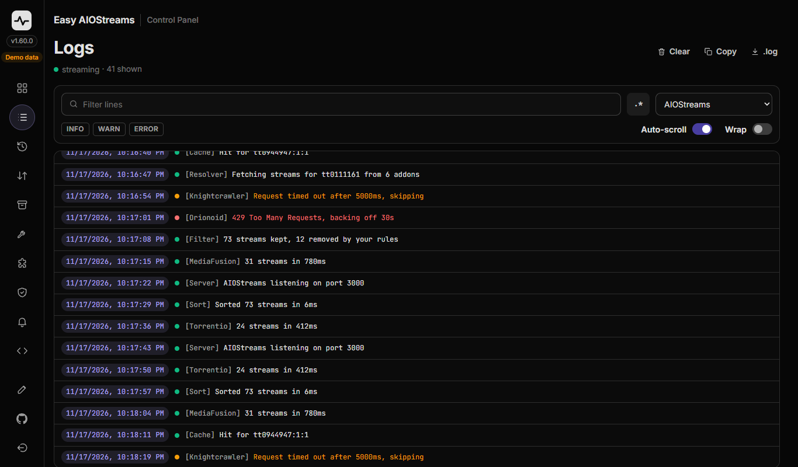
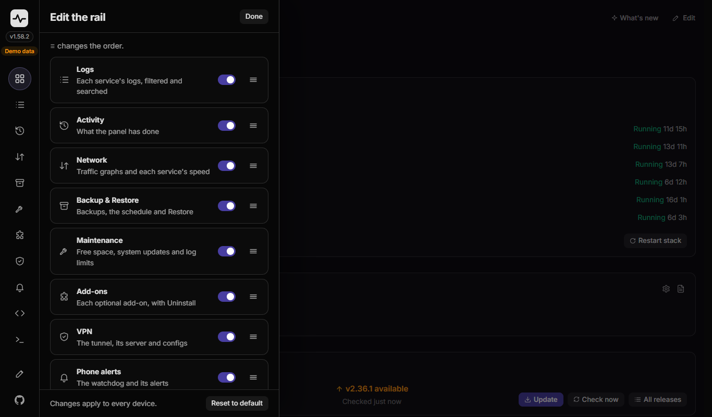
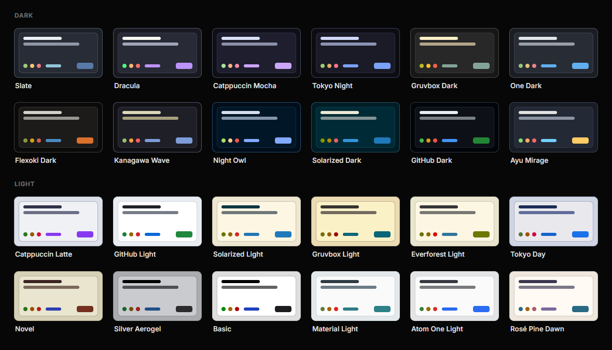
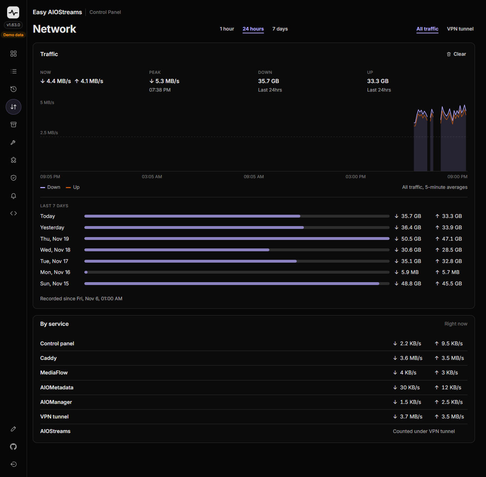
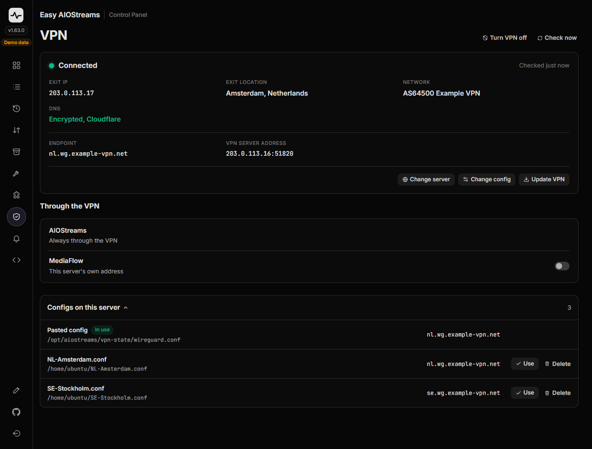
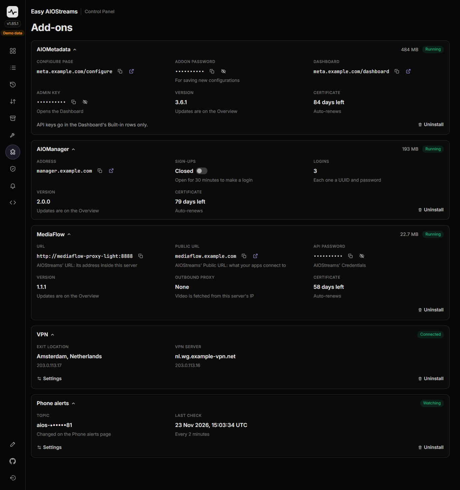
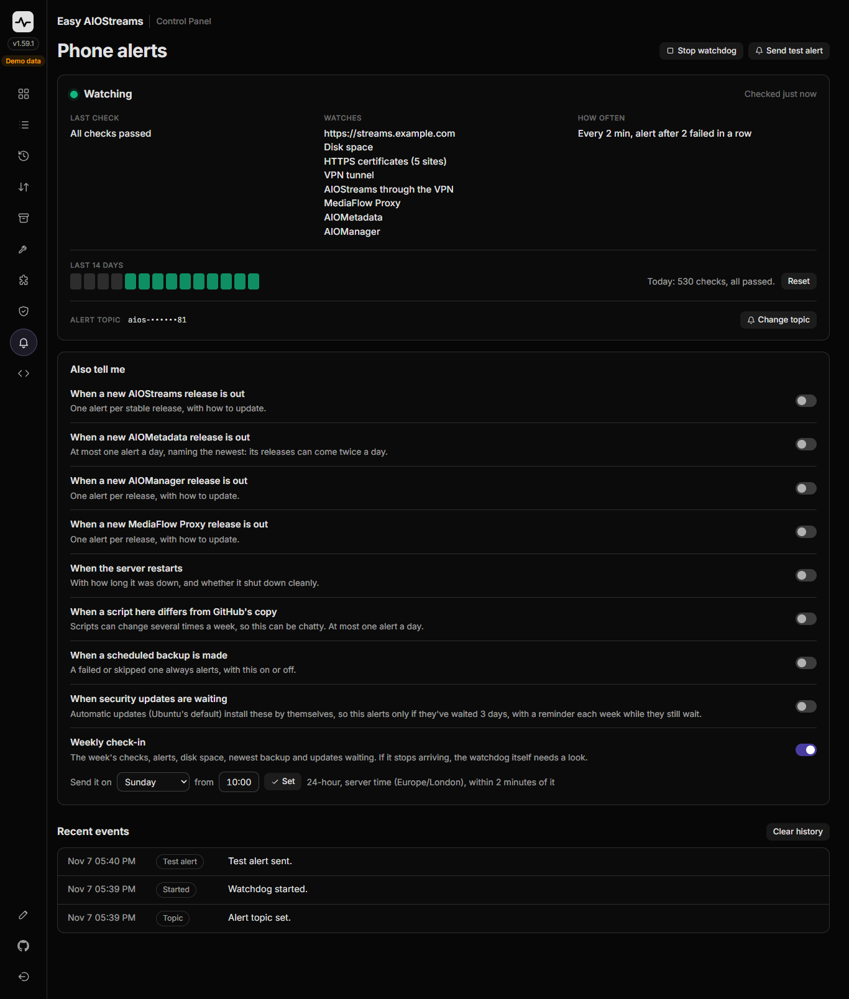
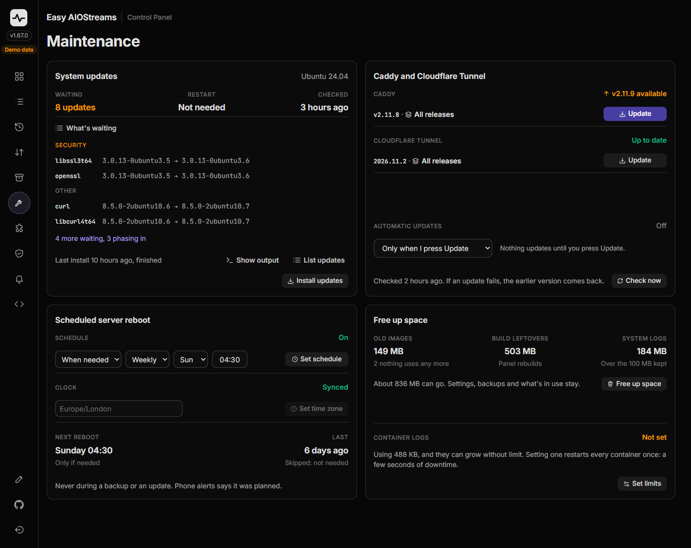
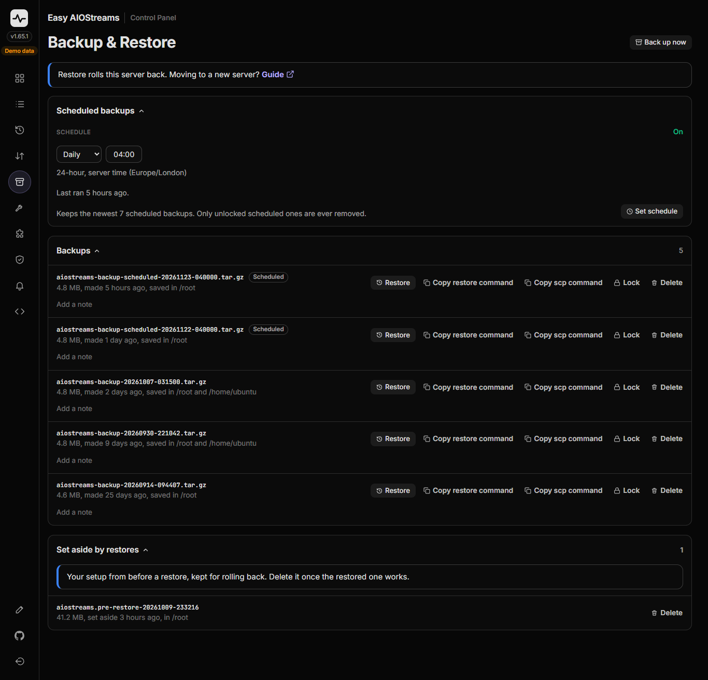

# Control Panel: Advanced Guide

> [!NOTE]
> **Beta.** The control panel is new. It's been used day to day, but not yet on every kind of setup. If something looks wrong, [open an issue](https://github.com/alpinezx/easy-aiostreams/issues).

A private web dashboard for the Easy AIOStreams stack: what's running, start, stop, restart, update, back up, and container logs. Every button runs your existing `setup-*.sh` scripts, so the panel can't drift from what the scripts do.

> Just want it running? → [Basic guide](../basic/control-panel.md)

---

## Where it lives

| Path | What's there |
| --- | --- |
| `/opt/aiostreams/control-panel` | The panel's code and `setup-ui.sh`, built straight from here. |
| `/opt/aiostreams/ui-state` | Settings, login, unlock token, activity history, `panel.log` (what was done from the panel), the Overview's and rail's layouts (`overview-layout.json`, `rail-layout.json`) and traffic history (`host-traffic.json`, `vpn-traffic.json`). Part of every backup. |
| `/opt/aiostreams/caddy.d/60-ui.caddy` | Its Caddy site, picked up through the drop-in folder. |

It runs as one container, `aios-ui`, on the shared `aios_shared` network with no published ports: only Caddy can reach it. `setup-ui.sh` only runs from `/opt/aiostreams/control-panel`; anywhere else it stops and says where it belongs.

## Install, update, uninstall

Install is a download into place, then the first run of `setup-ui.sh`:

```bash
curl -fsSL https://github.com/alpinezx/easy-aiostreams/archive/refs/heads/main.tar.gz | sudo tar xz -C /opt/aiostreams --strip-components=1 easy-aiostreams-main/control-panel
sudo bash /opt/aiostreams/control-panel/setup-ui.sh
```

After that the same command opens the menu.

- **4) Update** downloads the newest `control-panel` folder from `main` (replacing `app/`, `web/` and `tests/` so removed files don't linger) and rebuilds with the new `setup-ui.sh`. Answer **n** to rebuild from the files already there, for example after editing them. Login, unlock link and terminal key are kept; a failed or incomplete download changes nothing. To try `dev`: `sudo AIOS_UI_BRANCH=dev bash /opt/aiostreams/control-panel/setup-ui.sh`.
- **8) Uninstall** removes the container, its Caddy site, its image and `ui-state` (login, unlock token, history), then asks whether to delete `control-panel` too (**n** to reinstall from the same files, **y** to leave nothing). AIOStreams isn't touched. Delete the panel's DNS record afterwards if you're not reinstalling.

## How it's locked down

- **Caddy gate.** Without the unlock cookie, every URL on the subdomain is a bare 404, login page included. Opening `/unlock/<token>` once sets the cookie (each visit renews it). Menu option 5 makes a new token and signs out every browser.
- **Only Caddy reaches it.** No published ports, and the visitor's address and HTTPS are taken from forwarded headers only when they come from Caddy's own container (`app/proxy.py`), so nothing else on the Docker network can pose as a visitor.
- **Login.** scrypt-hashed password, 7-day signed session cookie (HttpOnly, Secure). 5 wrong passwords lock that address out for 15 minutes.
- **SameSite=Lax** on both cookies, so a link from another app (a phone alert) gets in, while other sites' POSTs still never carry them; every change in the panel is a POST. A rebuild updates Caddy's site file, reloading Caddy only if it changed.
- **No free-form commands.** The browser can only ask for actions from a fixed list (`app/actions.py`), and logs are limited to the stack's own containers.
- **No secrets shown.** `SECRET_KEY` and logins never reach the browser. Backups can be listed, created and deleted (delete removes every copy after a confirm; a locked one can't be deleted until unlocked) but not downloaded: copy them off with `scp`.
- **In the browser.** Every change needs the panel's own header and a same-site origin; a strict Content-Security-Policy allows only the panel's own scripts; anything from outside (container names, log lines, GitHub release notes) is shown as plain text, never HTML.

It is still root-equivalent on your server: it runs the scripts and talks to Docker (the container is privileged and shares the host's process namespace, running scripts on the host through `nsenter`). Treat the unlock link and password like SSH credentials.

Found a security problem? Report it privately from the repository's **Security** tab (Report a vulnerability), not in a public issue.

## What each button runs



| Button | Script and input |
| --- | --- |
| Start, Stop (AIOStreams' row), Restart stack | `setup-aiostreams.sh start`, `stop`, `restart` (menu options 3, 2, 4) |
| Restart (per service) | restarts that container through Docker (AIOStreams, MediaFlow, AIOMetadata, AIOManager, the Cloudflare Tunnel). The **Control panel** row restarts the panel itself and reloads the page; it has no Stop, as nothing could start it again |
| Update | `setup-aiostreams.sh update` with `--backup` and `--channel latest\|nightly` from the dialog (menu option 5) |
| Back up now | `setup-aiostreams.sh backup` |
| Scheduled backups: Set, Off | `setup-backup.sh schedule daily HH:MM`, `weekly <1-7> HH:MM`, `off` (writes `backup-schedule` and the systemd timer) |
| MediaFlow, AIOMetadata, AIOManager: Start, Stop, Update | the add-on's script with `start-<name>`, `stop-<name>`, `update-<name>` (`--backup` from the dialog), e.g. `setup-mediaflow.sh update-mediaflow` |
| AIOManager: Sign-ups switch | `setup-aiomanager.sh signups open 30` (closes by itself after 30 minutes), `signups close` |
| Phone alerts: Start, Stop, Send test alert | `setup-watchdog.sh install-timer`, `stop` (menu option 3 typed too, for older scripts), `test` |
| Phone alerts: Change topic | `setup-watchdog.sh set-topic`, topic on stdin (never on a command line or in Activity), then a test alert |
| Phone alerts: switches, check-in day and time, Reset, Clear history | written straight to `watchdog-state/options`, `tally` and `events` (as the script's `set-option` does) |
| Add-ons: Uninstall (AIOMetadata, AIOManager, MediaFlow) | `setup-aiostreams.sh backup` first if ticked, then the add-on's `uninstall`, with `remove-image` if ticked |
| Add-ons: Uninstall (Phone alerts) | `setup-watchdog.sh uninstall` (menu option 9; the panel asks first) |
| Add-ons: Uninstall (VPN) | backup first if ticked, then `setup-vpn-gluetun.sh uninstall` with `remove-image` and `delete-confs` as ticked |
| Add-ons: Uninstall (retired webhook relay) | `setup-aiostreams.sh remove-webhook-relay`; no backup (a restore leaves the relay out), its Python image left for Free up space |
| Turn VPN on, Turn VPN off | `setup-vpn-gluetun.sh on`, `off` (menu options 2 and 3) |
| Change server, Update VPN | `addresses` for the list, then `use-address <ip>`; `update [--backup]` (menu option 5) |
| Change config | `addresses <name>` for the new config's list, then `use-config <ip>` |
| Configs on this server: list, Use, Delete | `list-configs`; `use-file <path> <ip>`; `delete-config <path>` |
| Maintenance: Free up space | `setup-aiostreams.sh free-space`, handed to `setup-maintenance.sh` (as are the two below) |
| Maintenance: Scheduled server reboot, Set, Off | `setup-aiostreams.sh restart-schedule needed\|always daily HH:MM`, `... weekly <1-7> HH:MM`, `off` (writes `restart-schedule` and the systemd timer) |
| Maintenance: Caddy's Update | `setup-aiostreams.sh update-caddy`: pulls `caddy:2` and recreates only Caddy, keeping the earlier image as `caddy:aios-previous` until the new one answers, and putting it back if it doesn't |
| Maintenance: the Cloudflare Tunnel's Update | `setup-tunnel.sh update`, which keeps the earlier cloudflared as `cloudflare/cloudflared:aios-previous` until the new one connects |
| Maintenance: Automatic updates | `setup-aiostreams.sh auto-updates monthly` or `off`, handed to `setup-maintenance.sh` (writes `auto-updates` and the systemd timer) |
| Maintenance: Install updates, Set limits | `setup-aiostreams.sh system-updates`, `log-limits`, run on the host as their own systemd unit (`aios-maintenance`), since restarting Docker restarts the panel too. Output in `ui-state/maint.log`, exit code in `maint.log.code` |
| Maintenance: Clock, Change, Turn on time sync | `timedatectl set-timezone <zone>` (only a zone from `timedatectl list-timezones`) and `timedatectl set-ntp true` on the host. A server with no time sync service (some Debian images) gets a line saying to install `systemd-timesyncd` instead |
| Update (Scripts tab) | downloads GitHub's main copy through the API (raw links can be minutes stale), checks its SHA, replaces the script on the host. AIOStreams' row also replaces `setup-backup.sh` and `setup-maintenance.sh`; the watchdog's runs `setup-watchdog.sh refresh` so its timer's copy follows |
| Remove (Scripts tab) | deletes an add-on's script, only while that add-on isn't set up (no state folder) |
| What's new (Scripts tab, Overview) | reads `CHANGELOG.md` from the panel's update branch (kept 3 hours, a failure 10 minutes), marks entries newer than this panel's version and tags each New, Fixed or Docs from its bold lead |

These commands ask nothing. Where the menu would ask whether to go on with the VPN set up but off, they stop and say so. After each command the panel also types the old menu numbers (3, 2, 4 and 5, then 10 to exit; 3 then 10 for the add-ons' Stop), which only an older script that doesn't know the command reads; a panel test checks them against the scripts. Scripts run on the host with a terminal attached, like an SSH session. The main script's Reconfigure and the add-ons' first-time setups have no button.

## Logs



Each line is split as AIOStreams' own log viewer shows it: time, a dot for its JSON `level`, `[module]`, the message, then other fields. **INFO**, **WARN** and **ERROR** filter by level (none picked shows all). For Caddy, the Cloudflare Tunnel and the VPN tunnel, expected lines that look alarming (a restart, the viewer reconnecting, a closed page, a retried DNS lookup) are grey, since they're logged as warnings and errors themselves: **Hide noise** hides them with a count, **NOISE** shows only them, and a fold-out lists what's hidden and what's worth a look. These are display filters only. **Clear** (the bin) hides everything logged so far in the log shown or **All logs**, and stays hidden after a reload; Docker's own log file is left alone, since emptying it behind Docker's back breaks `docker logs`.

## The Overview



**Layouts.** **Edit** (Overview, top right) and **Edit rail** (rail's foot) open one drawer, for the Overview's cards or the rail's pages. Each is one layout per install, saved on the server (`overview-layout.json`, `rail-layout.json`), so every device matches. Overview stays first on the rail, and Edit rail, GitHub and Sign out at its foot. Something not on this server (the VPN, Phone alerts, an add-on) keeps its place in the order but isn't listed until it's set up. **Reset to default** restores the standard order (the rail's goes by use: Logs, Activity, Network, Backup & Restore, Maintenance, Add-ons, each add-on's page, Scripts, Terminal).

**Colours**, at the top of Edit, sets System, Light, Dark or a theme under **More…**, per browser (local storage `aios.theme`, not the server). `js/theme.js` applies it before the page draws, so nothing flashes; the login page, terminal and logo follow it.



**More…** has 24 themes, 12 dark and 12 light: Slate (the panel's own softer dark) and well-known schemes (Dracula, Catppuccin, Tokyo Night, Gruvbox, One Dark and Atom One Light, Flexoki, Kanagawa, Night Owl, Solarized, GitHub, Ayu, Everforest, Rosé Pine Dawn, Material, Novel, Silver Aerogel, Basic). Each keeps its published palette, with only the colours that fall short of the panel's contrast rules moved lighter or darker in their own hue (most often a light theme's amber).

**Recent log alerts** shows the latest warnings (amber) and errors (red) from every running service's log over the last day, newest first: five, plus five more behind **Show more**. Caddy's and the tunnel's lines are left out while a panel action runs (Restart stack, an update, a VPN switch, a backup) and for a minute after, and in the first three minutes after boot; other services' lines always show. It uses the Logs page's rules, so grey lines never reach it, and repeats from one service are one row with a count. A row opens that log. The card's **Clear** removes its rows on every device (saved in `ui-state/warn-cleared.json`) but leaves the Logs page alone. **Choose services** (a cog) picks the logs it reads, saved on the server: the panel, Caddy, the Cloudflare Tunnel and the VPN start on; AIOStreams (its own dashboard has the list), AIOMetadata, AIOManager and MediaFlow (mostly warnings about settings not entered yet) start off. Logs are read only while the Overview is open, at most once a minute.

**This server** is worked out as AIOStreams' dashboard does it, so the two agree: **CPU** is all cores over the last few seconds, with the load average under it, and sizes and speeds count in thousands (KB, MB, GB). Memory and Disk read used / total with the percentage and what's free. **Next reboot** links to the [scheduled server reboot](#maintenance-page), **Network** shows the speed now and today's totals (its arrow lists each service, as Network's By service does), and the HTTPS certificates open in a section below, folded to the soonest unless one needs a look.

**Services** shows each service's CPU as its share of the whole server, so the rows add up to roughly This server's CPU (Docker counts 100% per core instead). A CPU turns amber at 75% and red at 90% only after three readings in a row, so a short burst never colours it. **Recent CPU** draws the last couple of minutes.

**Version cards.** AIOMetadata, AIOManager and MediaFlow get a card like AIOStreams' once installed: the release they run, the newest, **Update** (with **Back up first**; the previous release is put back by itself if the new one doesn't start), **Check now** and **All releases**. AIOStreams' version is read from its running container's `package.json`, once per container. See each add-on's guide for its card.

**VPN card** (once the VPN is set up): **Connected** or **Disconnected**, where traffic leaves and how long the tunnel has been up (since gluetun last brought it up, or its container's start), the server, and gluetun's version (from its image) against the newest v3 release, checked like the add-ons' (kept 3 hours). Buttons: **Turn VPN off** (or on), **Update**, **Check now** and **All releases**. Turning it on with no config saved goes through the VPN page, which asks for one.

Through a [Cloudflare Tunnel](./home-hosting.md#phone-alerts-and-the-control-panel), the tunnel comes first in the Request flow and right after the panel in Services, and the certificate tile shows Cloudflare's certificates.

## Network page



Once a minute, whether or not the panel is open, it reads the byte counters of the server's own network card (the default route's, from the host's `/proc/1/net`) and, with the VPN on, gluetun's `tun0`. Minutes are kept for a day and hours for 30 days in `ui-state/host-traffic.json` and `vpn-traffic.json`, saved every few minutes, so an update or reboot loses only the minutes between and a backup carries the history. A minute with no reading is a gap, not zero; counters restarting from zero (a reboot, gluetun restarting) are a fresh start, not traffic.

**All traffic** and **VPN tunnel** switch the Traffic card. The graph is per minute over 1 hour, 5-minute averages over 24 hours and hourly over 7 days. The bin clears the history shown (or both) and starts again from now. **By service** is each container's speed from Docker's counters. AIOStreams on the VPN shares gluetun's network, so it's counted once, under the tunnel, which ends the list with whatever goes through it.

## VPN page



It appears on the rail once `setup-vpn-gluetun.sh` has set the VPN up, on or off.

- **Status.** Whether the tunnel is connected and where traffic leaves (exit IP, city, country, network), asked from inside the VPN container: `ipinfo.io`, then `ifconfig.co` and GeoJS (a shared exit address can run out a free limit), then plain IP lookups. The endpoint name and server address come from `vpn-state`; the panel reads only those lines, never the keys.
- **DNS** makes a lookup inside gluetun and reads its connections from `/proc/net/tcp`: DNS-over-TLS (port 853) to Cloudflare or Quad9 shows as encrypted, plain port 53 shows amber. A check is reused for a minute; **Check now** asks again.
- **Turn VPN off** keeps AIOStreams live through the switch; **Turn VPN on** waits for the tunnel before starting it. Both are the script with its own checks.
- **Change server** (when the endpoint is a name) looks it up again, pings each address and lists them fastest first; only the IPv4 address picked is sent back.
- **Update VPN** pulls the newest `qmcgaw/gluetun:v3` and restarts the stack only if the image changed and the VPN is on, with **Back up first** on by default. If the new release doesn't connect, the script puts the earlier one back.
- **Change config** sends the pasted config (or file, read in the browser) once over HTTPS. The panel checks both sections, real-looking keys and a valid endpoint, saves it as `vpn-state/upload.conf` (root only, mode 600) and returns only the endpoint and address. `use-config` keeps the old config in `vpn-state/previous/` (**Previous config**), installs the new one as `vpn-state/wireguard.conf` and switches with the usual tunnel check. If the tunnel doesn't connect, AIOStreams is left stopped rather than unprotected; **Use** on Previous config goes back.
- **Configs on this server** lists what `list-configs` finds: the pasted, previous and earlier configs, and `.conf` files in `/root` and the login user's home with `[Interface]`, `[Peer]`, `PrivateKey` and `Endpoint`. Paths and endpoints only, never keys. **Use** copies one into `vpn-state` and switches to it (the one left becomes Previous config, so two can be swapped). **Delete** takes only a path the list just found, and the config in use only while the VPN is off; deleting that one also removes its key from `vpn-state/docker-compose.vpn.yml`, so **Turn VPN on** then asks for a config (`use-config <ip> on`).
- **Through the VPN** lists AIOStreams (always) and a switch for MediaFlow once set up; see [Add-ons through the VPN](./vpn-setup.md#add-ons-through-the-vpn). With it on, the request flow and Network count MediaFlow under the tunnel.

Uninstalling is on the [Add-ons page](#add-ons-page): `uninstall` switches to direct first, removes gluetun (and its image, if ticked), and deletes `vpn-state` only once AIOStreams and Caddy are confirmed running, refusing otherwise. **Delete the .conf files** deletes the ones the list shows.

## Add-ons page



It appears once any optional add-on is installed (AIOMetadata, AIOManager, MediaFlow Proxy, the VPN, phone alerts, or the retired webhook relay with only its address and Uninstall). Each card shows what its script's Status and Show options print, its certificate and memory use; the VPN's and Phone alerts' are short, as their own pages hold the settings. Links have Copy and open buttons.

Secrets (AIOMetadata's addon password and admin key, MediaFlow's API password) aren't in the page: each is read from the add-on's settings only when its eye or Copy is pressed, sent with `Cache-Control: no-store`, and not kept. A MediaFlow outbound proxy shows without its login; the watchdog topic stays masked. MediaFlow's card lists what AIOStreams' Proxy settings ask for, by the same names: **URL** (inside the server, Copy only), **Public URL** and **API password** (**Credentials**). AIOManager's **sign-ups switch** opens sign-ups for 30 minutes or closes them now.

**Uninstall** asks for `uninstall` to be typed. **Back up first** runs a normal backup and stops if it fails (a restore brings the add-on back). Tick boxes answer the script's questions (removing images, the VPN's `.conf` files). Each script's `uninstall` does exactly what its menu's Uninstall does.

## Phone alerts page



It appears once the [watchdog](./watchdog.md) is set up over SSH (first-time setup asks you to subscribe in the ntfy app, so it stays a script job). It reads `watchdog-state/`: whether the timer runs, the last check, what it watches, 14 days of tallies as squares, and the optional switches; failed checks, alerts and recoveries are on the Activity page. The topic only reaches the browser masked (first five and last two characters). **Change topic** suggests a random topic (groups of four, no look-alike characters) with **Copy** and a link to it on ntfy.sh, so you can subscribe first.

## Maintenance page



Read when the page opens and kept for 5 minutes.

- **Free up space** counts untagged images and `viren070/aiostreams` images no container uses (only the space they alone hold), build cache Docker would remove, and the journal beyond 100 MB. Other tagged images, such as gluetun's while the VPN is off, are kept.
- **System updates** reads `apt list --upgradable` (security ones by their `-security` source), whether a restart is needed (`/var/run/reboot-required`, or on Debian a kernel installed since boot), when the lists were last refreshed, and the system's name from the host's `/etc/os-release`. `system-updates` runs `apt-get update` and `apt-get upgrade --with-new-pkgs` non-interactively, keeping changed config files, then brings the stack back as Start would (AIOStreams has `restart: "no"` in VPN mode; stopped on purpose stays stopped).
- **Caddy and Cloudflare Tunnel** (just **Caddy** without a tunnel) reads the running Caddy's release from its image's `CADDY_VERSION` and cloudflared's from `cloudflared --version`, and the newest releases on GitHub (`caddyserver/caddy`'s v2 line, `cloudflare/cloudflared`), kept for 3 hours like the other release checks; **Check now** asks again. A release counts as out once it's a day old, as the Docker images follow GitHub by some hours. **All releases** opens the release notes. **Automatic updates** is off unless chosen: **Automatically, once a month** runs `setup-maintenance.sh scheduled-auto-update` on the first Wednesday of the month at 03:15, server time, which updates Caddy and then cloudflared with the same rollbacks as the buttons. A run missed while the server was off is made up after the next start, once it has been up 10 minutes; it waits up to 30 minutes for a setup script or apt to finish, skipping the month if they're still going. Each run leaves a line in `auto-update-last-run`, and Activity lists it (with Phone alerts too, which doesn't report these). The Overview's updates pill names Caddy or cloudflared when a newer release is out, and says so first when the running cloudflared is 10 months old (Cloudflare supports a release for about a year).
- **Container logs**, at the foot of Free up space, reads `/etc/docker/daemon.json` and each container's log settings. `log-limits` adds `"log-opts": {"max-size": "10m", "max-file": "3"}`, keeping other settings, checks it with `dockerd --validate` where available, restarts Docker (putting the old file back if it won't start), then recreates the stack, add-ons and panel. `daemon.json` is outside `/opt/aiostreams`, so a new server shows **Not set** again after a restore.
- **Scheduled server reboot** reads `restart-schedule` (absent: off), `restart-last-run`, `aiostreams-restart.timer`, `timedatectl show`, and root's crontab for linux-aio-toolkit's own scheduled reboot (`# aio-toolkit: scheduled-reboot`), which it points out since both would run. The timer runs `setup-maintenance.sh scheduled-restart`: **When needed** does nothing unless a restart is needed; it skips a server up less than 10 minutes, and waits up to 30 minutes for a setup script or apt to finish, skipping if they're still going. It leaves `watchdog-state/planned-restart` so the watchdog's alert says it was planned and comes quietly. A time missed while off isn't made up (`Persistent=false`). Changing the time zone moves every scheduled time with it.

## Backups and restores



Backups are listed from root's and the login user's homes, merged by name. Locks and notes are in `ui-state/backup-meta.json`, which scheduled backups also read so they never remove a locked one; over SSH, `setup-backup.sh keep` and `unkeep` change the same lock.

**Scheduled backups** reads `backup-schedule`, `backup-last-run` (see the [backup guide](./backup-restore.md#scheduled-backups)) and whether `aiostreams-backup.timer` is active; if the schedule is on but the timer isn't, it says so and **Set** starts it again. Names with `-scheduled-` get the **Scheduled** label. The Overview's **Last backup** is the newest of any kind, amber only when the last scheduled run failed or was skipped. Without Phone alerts (or while it's stopped), the panel adds restarts, scheduled backups and skipped scheduled reboots to Activity itself: once a minute it compares the kernel's boot ID and the last-run files with what it saw before (kept in `ui-state/server-events.json`). While Phone alerts is on it leaves them to the watchdog.

A restore moves the current install aside to `/opt/aiostreams.pre-restore-<date>-<time>` as a rollback copy, which the script never removes. Those show under **Set aside by restores** with Delete; the panel only deletes folders with exactly that name, next to the install folder.

Over SSH, a restore rebuilds the panel from the backup (if it was running then), after checking its subdomain. From the panel's own **Restore**, the panel stays up so the restore isn't cut off, then restarts itself a few seconds after (asking you to sign in again if the backup's login differs). While any action runs, the panel refuses to restart.

**Reboot server** (This server on the Overview, and Maintenance when updates need it) asks first and refuses while an action runs. Everything uses `restart: unless-stopped`, so the stack and panel come back by themselves.

---

[← Basic guide](../basic/control-panel.md) · [Other Scripts](../other-scripts.md)
