# Control Panel: Basic Guide

> [!NOTE]
> **Beta.** The control panel is new. It's been used day to day, but not yet on every kind of setup. If something looks wrong, [open an issue](https://github.com/alpinezx/easy-aiostreams/issues) with a screenshot.

A private web page for your AIOStreams server. See at a glance whether everything is up, start, stop, restart, update and back up with a button, read the logs, and (if you switch it on) open a terminal, all from your phone or browser instead of SSH.

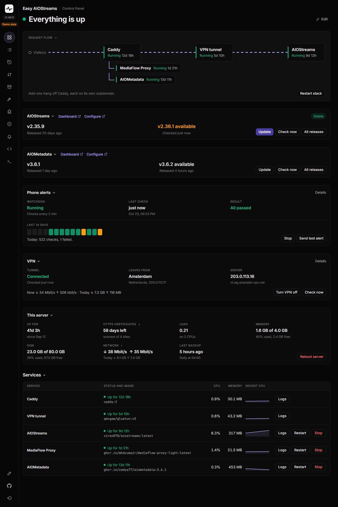

⚠️ **Needs AIOStreams installed first** with `setup-aiostreams.sh`, and a **spare subdomain** for the panel, for example `panel.yourdomain.xyz`.

> Want the full explanation of how it works and how it's locked down? → [Advanced guide](../advanced/control-panel.md)

---

## 1. Point a subdomain at your server

**This does:** gives the panel its own address, separate from AIOStreams.

At your domain provider, add an **A record** for a new subdomain (for example `panel`) pointing at the same IP as your AIOStreams domain. Same as you did for the main domain in the [Quick start](../../README.md#confirm-your-dns-is-actually-pointing-at-your-server-first).

---

## 2. Download the panel

**This does:** puts the panel's files in `/opt/aiostreams/control-panel`, next to the rest of your install.

```bash
curl -fsSL https://github.com/alpinezx/easy-aiostreams/archive/refs/heads/main.tar.gz | sudo tar xz -C /opt/aiostreams --strip-components=1 easy-aiostreams-main/control-panel
```

---

## 3. Install it

**This does:** builds the panel, adds its HTTPS site to Caddy, and sets up your login.

```bash
sudo bash /opt/aiostreams/control-panel/setup-ui.sh
```

It asks for:
1. The subdomain from step 1
2. A username and password for the panel (the password needs at least 10 characters)

It takes a minute or two the first time. At the end it prints an **unlock link**, something like `https://panel.yourdomain.xyz/unlock/...`.

---

## 4. Open the unlock link once

**This does:** lets your browser see the panel at all. Without it, the address just shows "Not found", so nobody else can even find the login page.

Open the unlock link once in each browser you'll use (phone, laptop). It takes you to the login page. After that, bookmark the plain address (`https://panel.yourdomain.xyz`) and use that.

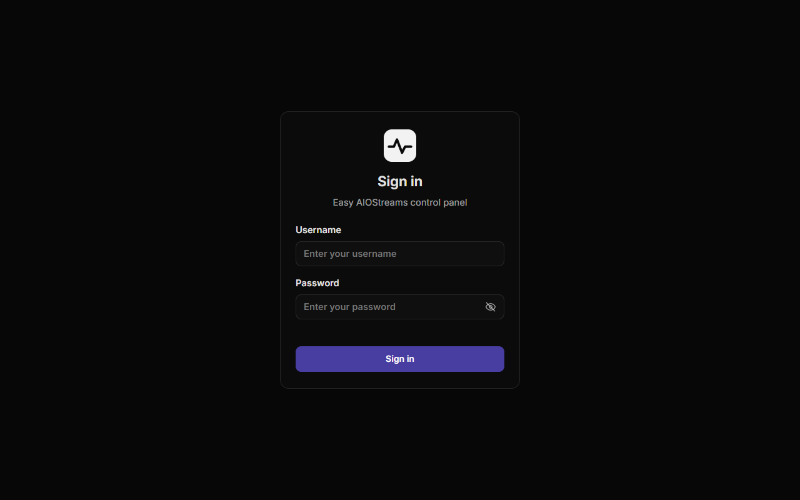

Treat the unlock link like a password. If it ever leaks, make a new one (see [Everyday use](#everyday-use)).

---

## What's in it

**Overview.** Whether everything is up; a card with links to AIOStreams' **Dashboard** and **Configure** pages, the version you're running, the latest release and whether you're up to date; the path a request takes through Caddy (and the VPN, if you use it); and each service with its CPU, memory and a **Logs** button. **Update** (which also switches between stable and nightly) sits in the version card, **Restart stack** by the request path, and **Stop** (or **Start**) on AIOStreams' row; they do the same as the matching options in `setup-aiostreams.sh`. Stop leaves Caddy running. **This server** shows uptime, load, memory, disk, the last backup and **Network**: what's going in and out right now and today's totals, with a link to the Network page. Below them, the days left on each HTTPS certificate, your main domain's and each add-on's subdomain's, folded to the soonest one; that section opens by itself if one isn't renewing. With [AIOMetadata](./aiometadata.md) installed, it gets a card of its own under AIOStreams' (its version, Update, and its Dashboard and Configure links) and a row in Services. With the [VPN](./vpn-setup.md) set up, it gets a card too: whether the tunnel is connected, where your traffic leaves from, which server it uses and what's going through it, with **Turn VPN off** (or on) and **Check now**. **Edit**, beside the headline, lets you hide the cards you don't need and drag the rest into the order you like; it's saved on the server, so every device shows the same. **Reset to default** in that drawer puts back the standard layout: the request flow folded, then AIOStreams, the add-ons' cards, This server and Services. Click a card's title to fold it to one line of what matters most; anything that needs a look stays on that line. Folds are remembered by each browser, so a phone can keep cards folded while a desktop shows them open.

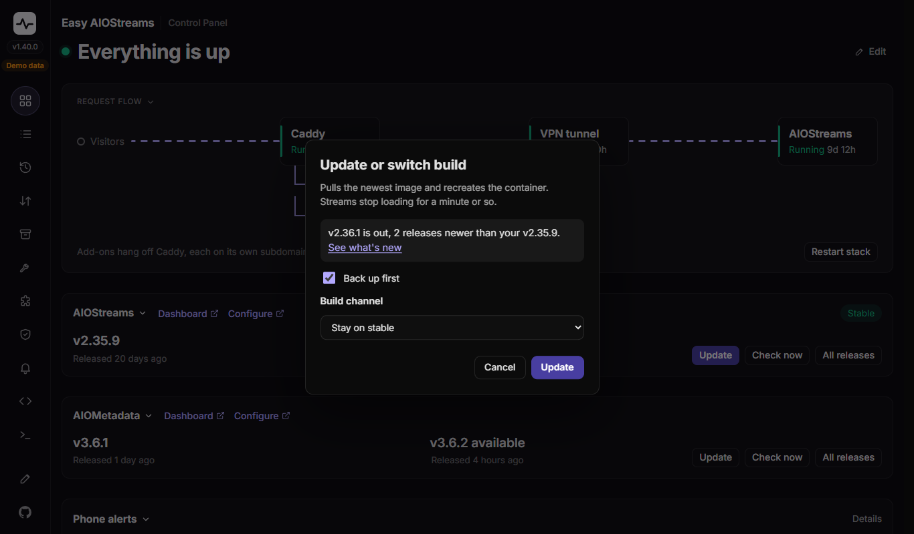

The pages are icons down the left; point at one to see its name. On a phone it all stacks into one column, and the pages are in the menu at the top left:

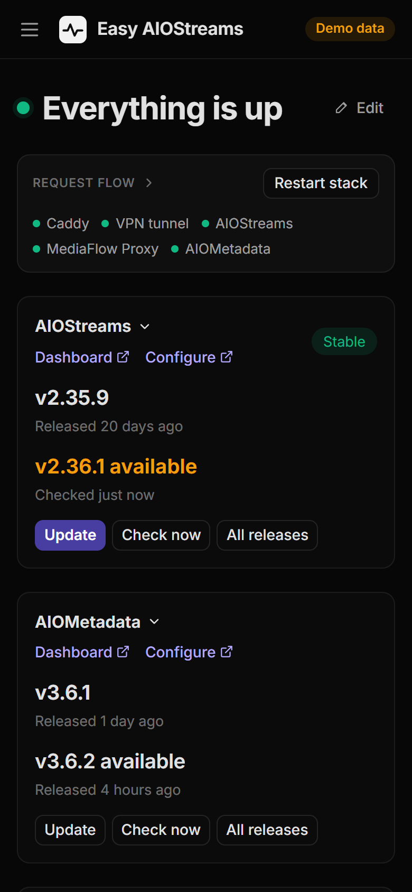 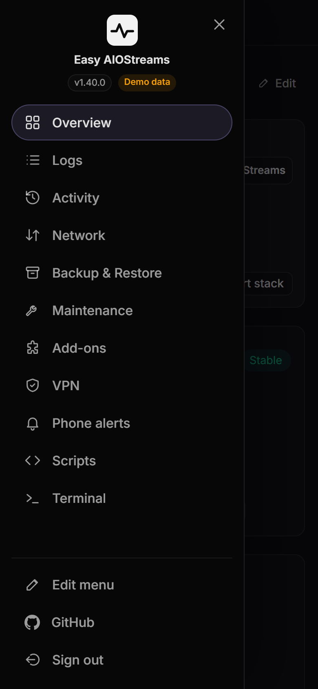

**Edit menu**, the pencil at the foot of the rail, opens a drawer on the left listing the pages. Drag them into the order you like, or switch off the ones you don't use. Overview always stays first, and Edit menu, GitHub and Sign out stay at the foot. Like the Overview's layout, it's saved on the server, so every device shows the same. The standard order goes by how often each page is used: Logs, Activity, Network, Backup & Restore, Maintenance, Add-ons (with VPN and Phone alerts under it, once set up), Scripts and Terminal.

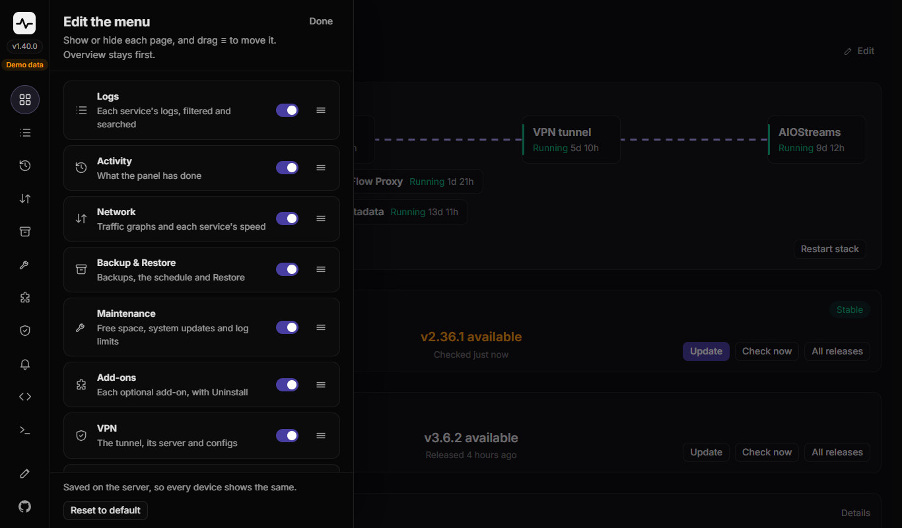

**Logs.** Live logs for AIOStreams, Caddy and each add-on, picked from a list. Filter the lines (or match a pattern with `.*`), show only INFO, WARN or ERROR, and copy or download what you see.

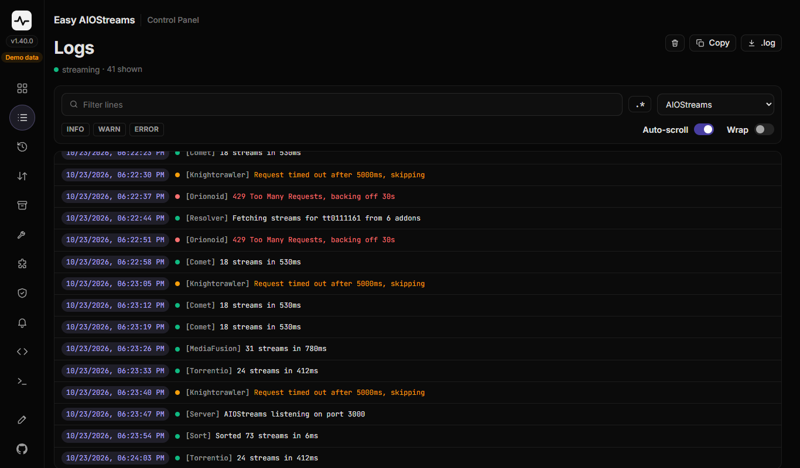

**Activity.** Every button you pressed and what it printed, so you can check how an update or backup went. The bin on each entry removes it; **Clear activity** removes them all.

**Network.** How much your server is sending and receiving. The **Traffic** card shows the speed now, the busiest moment (**Peak**) and how much went down and up, over **1 hour**, **24 hours** or **7 days**, with a graph, then a bar for each of the last 7 days. **Whole server** counts everything in and out of the server; with the VPN set up, **VPN tunnel** shows just what goes through it. **By service** lists each container's speed right now. History is kept for 30 days and goes into backups with the panel's other settings; **Clear history** starts it again from now.

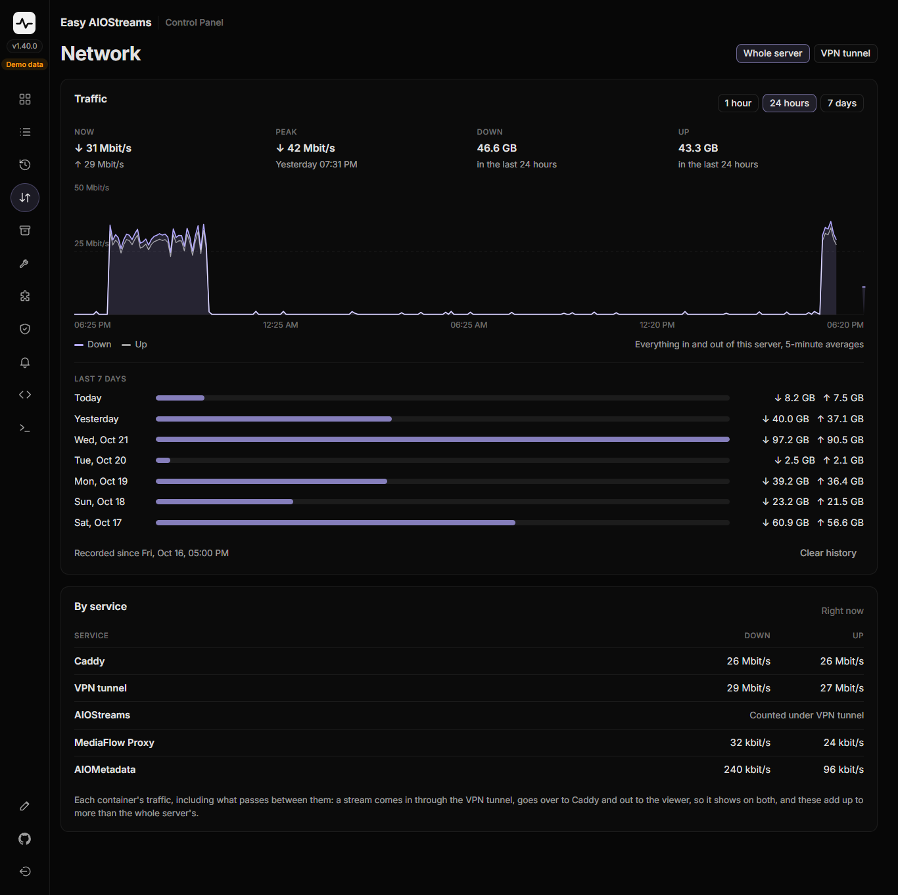

**Backup & Restore.** **Back up now** makes the same backup as `setup-aiostreams.sh` option 7. Each backup shows the AIOStreams version it holds, and can be locked (so it can't be deleted by accident) and given a note. Backups made by **Update** label themselves, for example "Before switching stable → nightly".

**Scheduled backups**, at the top, makes them by itself: **Off**, **Daily** or **Weekly** (with a day), at a 24-hour time you type, by the server's clock, then **Set**. It says when the last one was made, and turns amber if one failed or was skipped. Scheduled ones are marked **Scheduled**; the newest 7 are kept and older scheduled ones removed, while yours, ones made before an update and locked ones never are. The Overview's **This server** card shows how old the newest backup is. More in the [backup guide](./backup-restore.md#scheduled-backups).

**Restore** rolls your AIOStreams setup back to a backup, with no questions: AIOStreams and its configs, Caddy, the add-ons and the panel. Nothing else on the server changes. It's for this same server only: before anything changes, the panel checks that the backup has the same domains as the running install and that they point here. If anything doesn't match (a different domain, a backup from before October 2026, a switched-off VPN, too little disk), it refuses and gives you the command to run over SSH instead, where the restore can ask you what to do. You type `restore` to confirm, the current install is moved aside rather than deleted, and **Restart panel** at the end loads the restored install. Moving to a new server is always done over SSH.

**Copy restore command** and **Copy scp command** give you ready-made commands for restoring over SSH or copying a backup off the server.

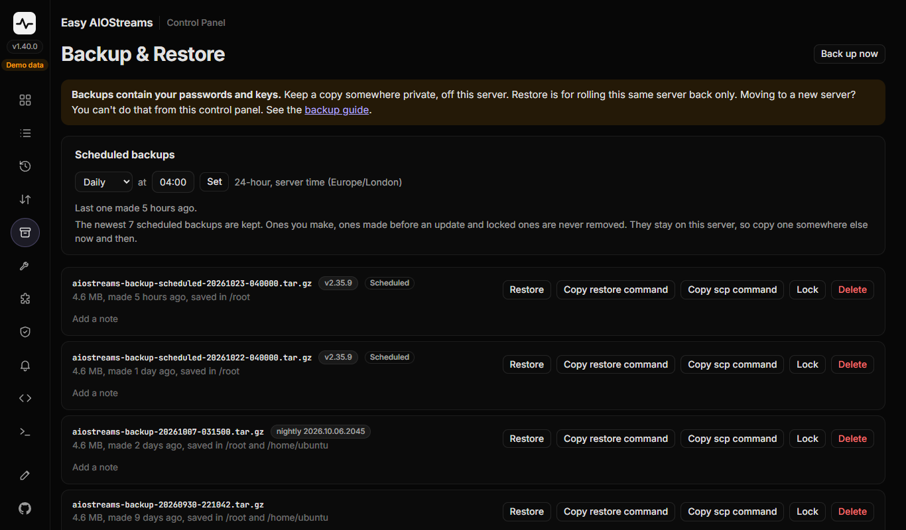

**Scripts.** At the top, the panel's own version, whether GitHub has a newer one, and **Update** (see [Updating the panel](#updating-the-panel)). Below it, every setup script: whether it's on this server, and **Differs from GitHub** when your copy doesn't match the current one. **Copy** gives the command to run it over SSH (point at Copy to see it), **Update** replaces it with GitHub's newest copy after a confirm (downloaded and checked first, so a failed download changes nothing; the command is still there to copy if you'd rather use SSH), and **Run in terminal** types the command into the panel's terminal for you to check and send with Enter (greyed out while the terminal is off). Once an add-on is uninstalled, **Remove** deletes its script from the server too; **Get and run** fetches it again any time.

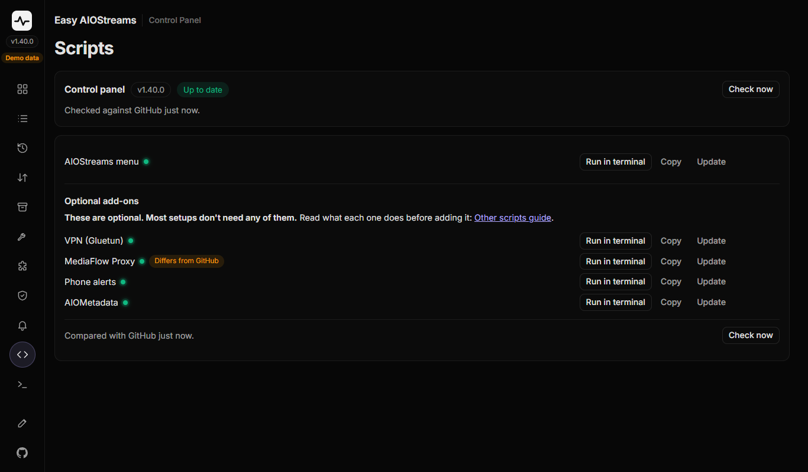

**VPN (once you've set it up with the [VPN script](./vpn-setup.md)).** Whether the tunnel is connected, where your traffic leaves from (IP, city and network), whether its DNS is encrypted and by whom (Cloudflare and Quad9, both on purpose so one can stand in for the other), and which server it uses. **Turn VPN off** and **Turn VPN on** switch modes with the same checks as the script. **Change server** lists the other addresses your config's server name has, timed from your server and fastest first, and switches to the one you pick; handy when one turns slow. **Change config** takes a new config from your VPN provider, pasted in or picked as a file. **Update VPN** gets the newest gluetun release, and only restarts anything if there was one. Under the card, **Configs on this server** lists every WireGuard config the server holds: the one in use, **Previous config** (the one you used before your last change), and `.conf` files in your home folder. Each one not in use has **Use** and **Delete**, so going back to the previous config is just **Use** on it, with its old address already picked. With the VPN off, the one it would use can be deleted too, leaving no config on the server; **Turn VPN on** then asks you to paste one. The tunnel's traffic graph is on the **Network** page, and uninstalling the VPN is on the **Add-ons** page.

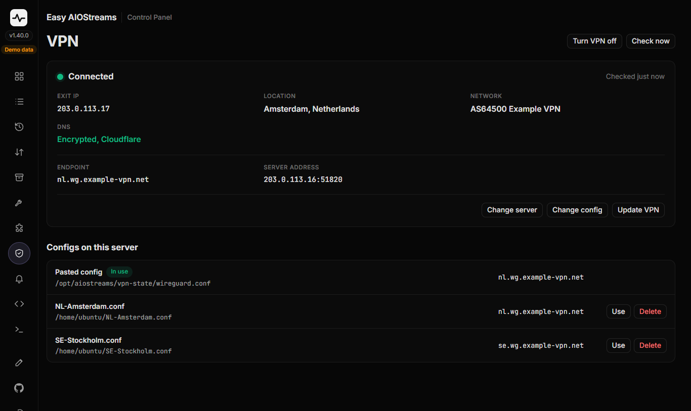

**Phone alerts (once you've set up the [watchdog](./watchdog.md)).** Whether it's watching, the last check and what it watches, a square per day for the last 14 days (green all passed, amber some failed) with **Reset**, and recent events (failures, alerts, recoveries, restarts) with **Clear history**. **Start/Stop watchdog** and **Send test alert** sit at the top. **Change topic** suggests a new topic with a **Copy** button for the ntfy app, and sends a test alert to it as soon as it's saved; the topic itself is only ever shown masked. **Also tell me** has six switches, off to start with: an alert when a new AIOStreams release is out (each nightly build, if you run nightly), one when the server restarts, one when a script here differs from GitHub's copy (at most one a day), one when a scheduled backup is made (a failed or skipped one alerts regardless), one when security updates have waited 3 days (Ubuntu normally installs them by itself), and a weekly check-in on the day and time you pick (by the server's clock, whose time zone it names). Each alert on your phone has an **Open panel** button that opens this page. Uninstalling phone alerts is on the **Add-ons** page; afterwards this page goes, and the Scripts tab offers **Remove** for its script.

**Add-ons (once you've installed one).** A card for each optional add-on you have: [AIOMetadata](./aiometadata.md), [MediaFlow Proxy](./mediaflow-proxy.md), the [VPN](./vpn-setup.md) and phone alerts. Each shows its links (with **Copy** and an open button), its passwords and keys as dots until you press the eye (or **Copy**), whether it's running, its memory use and its certificate. **Uninstall** at the foot of each card removes that add-on, like its script's Uninstall: type `uninstall` to confirm, with **Back up first** ticked (so a restore can bring it back) and, where it has them, tick boxes for removing its images. AIOStreams and the other add-ons stay.

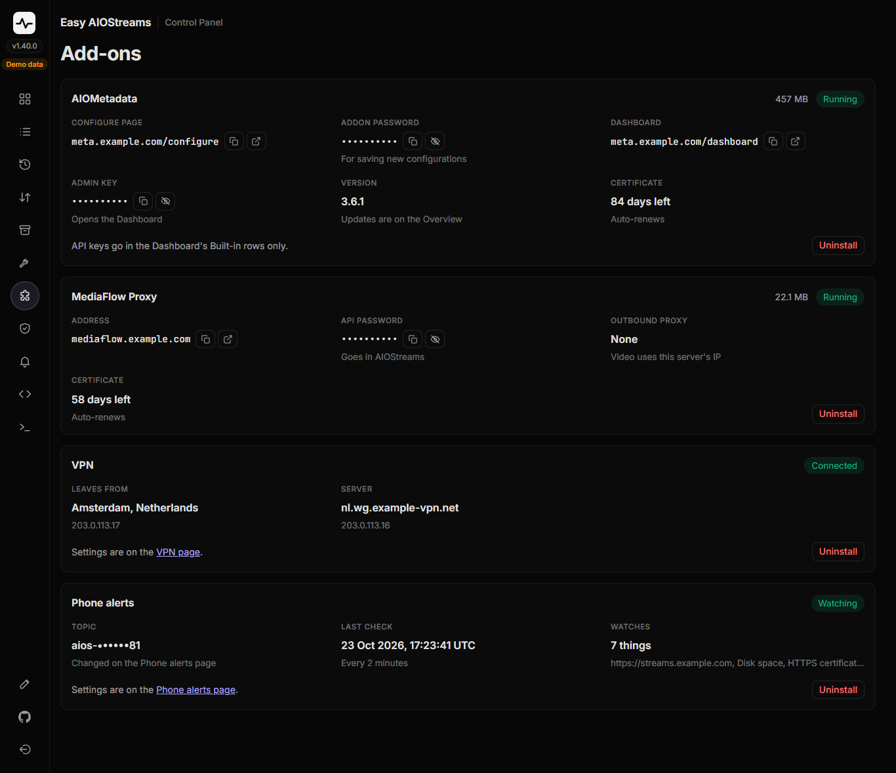


**Maintenance.** Upkeep that's easy to forget, one card each, with its button at the bottom right:
- **Free up space**: what can go and how big it is: AIOStreams images nothing uses any more (each update leaves the old one behind, and switching channel leaves the other channel's), leftovers from rebuilding the panel, and system logs beyond the newest 100 MB. Nothing in use, none of your settings and none of your backups are touched.
- **System updates**: how many of Ubuntu's updates are waiting (amber when some are for security), whether a restart is needed to finish them, and **Install updates**, the same as `apt upgrade` over SSH, keeping any config files you've changed. AIOStreams' own updates stay on the Overview.
- **Container logs**: whether Docker caps each container's log (at 10 MB), and **Set limits** if it doesn't. Without a cap, logs can grow until the disk fills.

If Docker itself is updated, or the log limits are set, every container restarts for a few seconds, the panel included. Those jobs run on the server itself, so they carry on while the page reconnects, and how the last one ended shows under the cards, with its output.

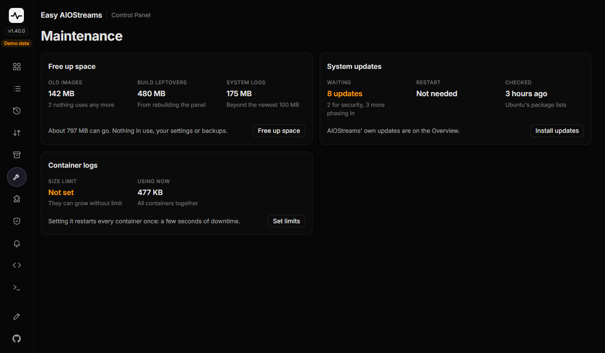

**Terminal (optional, off until you switch it on).** A shell on the server in your browser, behind a second key of its own. Handy on a phone. See below.

---

## Turning on the terminal

```bash
sudo bash /opt/aiostreams/control-panel/setup-ui.sh
```

Choose **8**, then **1**. It shows a **terminal key** once: save it in your password manager. Reload the panel and **Terminal** appears in its menu; type the key there to open it.

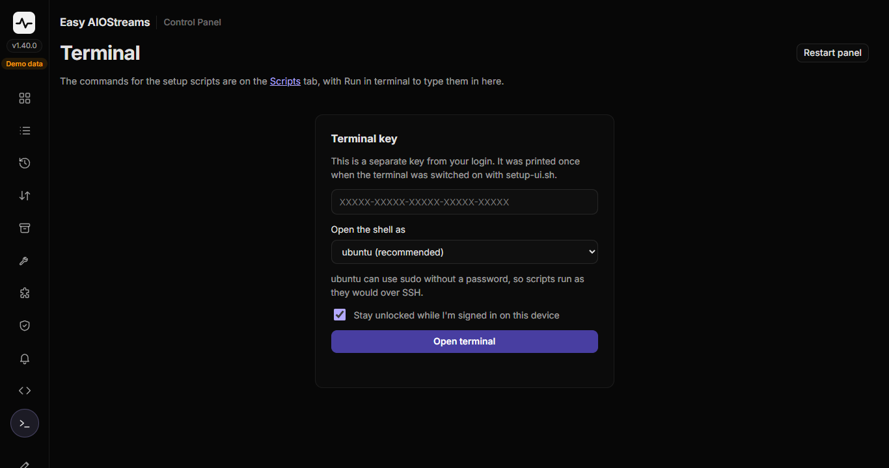

The **Scripts** tab's **Run in terminal** buttons then type a script's command in here for you.

---

## Everyday use

Run the same command any time for the panel's menu:

```bash
sudo bash /opt/aiostreams/control-panel/setup-ui.sh
```

- **1) Status**, **2) Start**, **3) Stop**
- **4) Update**: download the newest version from GitHub and rebuild (see below)
- **5) Make a new unlock link**: signs out every browser
- **6) Change username/password**
- **7) Show the unlock link**
- **8) Web terminal**: turn on or off, make a new key
- **9) Uninstall**: removes the panel; AIOStreams isn't touched

## Updating the panel

The panel shows its version under its logo and on the **Scripts** tab, and checks GitHub for a newer one. When there is one, the chip turns amber and the Scripts tab offers **Update to** the new version. It downloads it and rebuilds the panel, which is away for about a minute; the page reloads by itself. AIOStreams isn't touched, and your login, unlock link and terminal key stay the same. If the download fails, nothing changes, and the Scripts tab shows what happened.

Over SSH, the menu's **4) Update** does the same. That's the way to update a panel from before it had its own Update button, or one that won't start:

```bash
sudo bash /opt/aiostreams/control-panel/setup-ui.sh
```

Run that over SSH, not from the panel's own Terminal tab (rebuilding the panel would cut that terminal off). The panel's own Update button doesn't have that problem: it runs the update outside the panel.

---

[← Other Scripts](../other-scripts.md) · [Advanced guide →](../advanced/control-panel.md)
