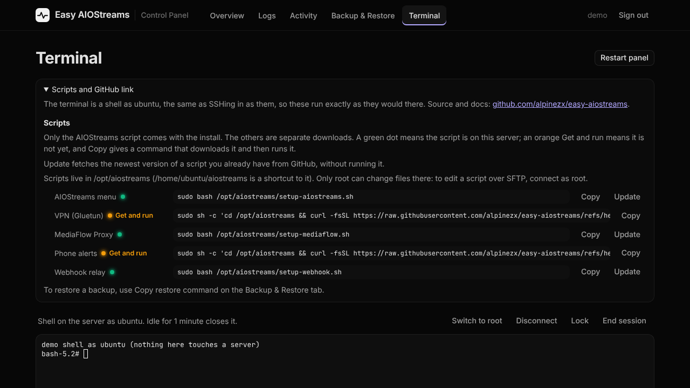

# Control Panel: Basic Guide

> [!NOTE]
> **Beta.** The control panel is new. It's been used day to day, but not yet on every kind of setup. If something looks wrong, [open an issue](https://github.com/alpinezx/easy-aiostreams/issues) with a screenshot.

A private web page for your AIOStreams server. See at a glance whether everything is up, start, stop, restart, update and back up with a button, read the logs, and (if you switch it on) open a terminal, all from your phone or browser instead of SSH.


⚠️ **Needs AIOStreams installed first** with `setup-aiostreams.sh`, and a **spare subdomain** for the panel, for example `panel.yourdomain.xyz`.

> Want the full explanation of how it works and how it's locked down? → [Advanced guide](../advanced/control-panel.md)

---

## 1. Point a subdomain at your server

**This does:** gives the panel its own address, separate from AIOStreams.

At your domain provider, add an **A record** for a new subdomain (for example `panel`) pointing at the same IP as your AIOStreams domain. Same as you did for the main domain in the [Quick start](../../README.md#confirm-your-dns-is-actually-pointing-at-your-server-first).

---

## 2. Download the panel

**This does:** puts the panel's files in `/opt/aiostreams/control-panel`, next to the rest of your install.

```bash
curl -fsSL https://github.com/alpinezx/easy-aiostreams/archive/refs/heads/main.tar.gz | sudo tar xz -C /opt/aiostreams --strip-components=1 easy-aiostreams-main/control-panel
```

---

## 3. Install it

**This does:** builds the panel, adds its HTTPS site to Caddy, and sets up your login.

```bash
sudo bash /opt/aiostreams/control-panel/setup-ui.sh
```

It asks for:
1. The subdomain from step 1
2. A username and password for the panel (the password needs at least 10 characters)

It takes a minute or two the first time. At the end it prints an **unlock link**, something like `https://panel.yourdomain.xyz/unlock/...`.

---

## 4. Open the unlock link once

**This does:** lets your browser see the panel at all. Without it, the address just shows "Not found", so nobody else can even find the login page.

Open the unlock link once in each browser you'll use (phone, laptop). It takes you to the login page. After that, bookmark the plain address (`https://panel.yourdomain.xyz`) and use that.


Treat the unlock link like a password. If it ever leaks, make a new one (see [Everyday use](#everyday-use)).

---

## What's in it

**Overview.** Whether everything is up, which build and version you're on, the path a request takes through Caddy (and the VPN, if you use it), and each service with its CPU, memory and a **Logs** button. **Restart**, **Stop** and **Update • Switch build** do the same as the matching options in `setup-aiostreams.sh`.


On a phone it all stacks into one column:


**Logs.** Live logs for AIOStreams, Caddy and each add-on. Filter, hide warnings, copy or download what you see.


**Activity.** Every button you pressed and what it printed, so you can check how an update or backup went.

**Backup & Restore.** **Back up now** makes the same backup as `setup-aiostreams.sh` option 7. Each backup can be locked (so it can't be deleted by accident) and given a note. **Copy restore command** and **Copy scp command** give you ready-made commands for restoring or copying a backup off the server.


**Terminal (optional, off until you switch it on).** A shell on the server in your browser, behind a second key of its own. Handy on a phone. See below.

---

## Turning on the terminal

```bash
sudo bash /opt/aiostreams/control-panel/setup-ui.sh
```

Choose **8**, then **1**. It shows a **terminal key** once: save it in your password manager. Reload the panel and a **Terminal** tab appears; type the key there to open it.


Above the terminal, **Scripts and GitHub link** has copy buttons for every script: run it, or update it from GitHub.



---

## Everyday use

Run the same command any time for the panel's menu:

```bash
sudo bash /opt/aiostreams/control-panel/setup-ui.sh
```

- **1) Status**, **2) Start**, **3) Stop**
- **4) Rebuild**: after getting a new version (see below)
- **5) Make a new unlock link**: signs out every browser
- **6) Change username/password**
- **7) Show the unlock link**
- **8) Web terminal**: turn on or off, make a new key
- **9) Uninstall**: removes the panel; AIOStreams isn't touched

## Updating the panel

Download it again (step 2), then choose **4) Rebuild**. Your login, unlock link and terminal key stay the same.

```bash
curl -fsSL https://github.com/alpinezx/easy-aiostreams/archive/refs/heads/main.tar.gz | sudo tar xz -C /opt/aiostreams --strip-components=1 easy-aiostreams-main/control-panel
sudo bash /opt/aiostreams/control-panel/setup-ui.sh
```

---

[← Other Scripts](../other-scripts.md) · [Advanced guide →](../advanced/control-panel.md)
