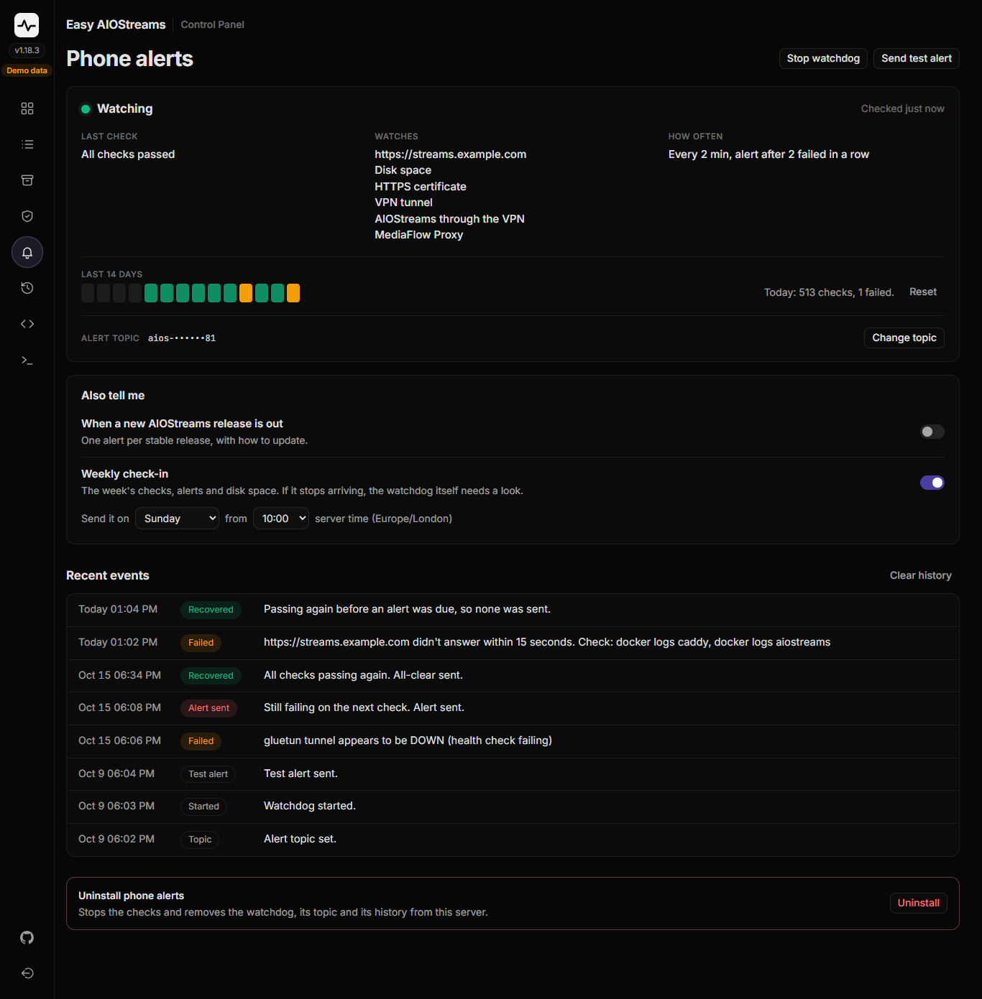

# Watchdog Alerts: Basic Guide

For a phone notification when your AIOStreams server needs you: the site stops answering, the disk is nearly full, or the HTTPS certificate isn't renewing. With the [VPN layer](./vpn-setup.md), [MediaFlow Proxy](./mediaflow-proxy.md) or [AIOMetadata](./aiometadata.md) set up, it watches those too.

⚠️ **Needs AIOStreams installed first** with `setup-aiostreams.sh`. Nothing else is required.

> Want the full explanation of how this works under the hood, or hit a snag? → [Advanced guide](../advanced/watchdog.md)

---

## 1. Get the ntfy app

**This does:** gives you somewhere to actually receive the alert.

Install [ntfy](https://ntfy.sh) from the Play Store or App Store, or just keep `https://ntfy.sh` open in a browser tab. Either works. No account, no signup, nothing to register.

---

## 2. Install and run the script

**This does:** installs the watchdog and walks you through first-time setup.

```bash
sudo curl -fsSL https://raw.githubusercontent.com/alpinezx/easy-aiostreams/refs/heads/main/setup-watchdog.sh -o /opt/aiostreams/setup-watchdog.sh
sudo bash /opt/aiostreams/setup-watchdog.sh
```

Choose **2) Start**. It'll suggest a random topic name (or let you type your own; pick something long and hard to guess, since anyone who knows it can see your alerts), then pause so you can subscribe before it sends a test alert.

---

## 3. Subscribe to the topic

**This does:** confirms you'll actually see the alerts, not just that the script thinks it sent one.

In the ntfy app (or your browser tab), subscribe to the exact topic name the script showed you. Then go back to the script and press Enter to receive the test alert.

---

## 4. Confirm the test alert arrived

**This does:** proves delivery actually works, before you ever need it for real.

You should see **🔔 Test alert**: *"If you see this, alerts are working."*

If nothing shows up within a few seconds, don't move on yet. See the [advanced guide's troubleshooting section](../advanced/watchdog.md#troubleshooting).

---

## What you'll get

- **🚨 AIOStreams is down** if a check fails twice in a row (not on a single blip). It says what failed and how to fix it: the site isn't answering, Caddy is down, the certificate is broken, or, when they're set up, the VPN tunnel, MediaFlow Proxy or AIOMetadata.
- **✅ AIOStreams is back** once everything passes again. One alert each way, not a repeat every check.
- **⚠️ Disk nearly full** at 90%, and **⚠️ Certificate not renewing** if Caddy hasn't renewed it with 10 days left. Each sends a quiet all-clear once it's fine again.
- **Silence when you stop something on purpose** from its own menu (Stop AIOStreams in `setup-aiostreams.sh` or the control panel, Stop in `setup-mediaflow.sh` or `setup-aiometadata.sh`), or turn the VPN off. Only unexpected stops alert.

With the [control panel](./control-panel.md), each alert has an **Open panel** button that opens its **Phone alerts** page.

Six more you can switch on, from the script's **Extra alerts** menu or the control panel's Phone alerts page (all off to start with):
- **When a new AIOStreams release is out**: one alert per stable release, with how to update. On nightly, one per nightly build; those come out daily or more, so it can be chatty.
- **🔄 When the server restarts**, with how long it was down, or a note that it didn't shut down cleanly (a crash or power cut). A watchdog set up before this was a switch keeps it on.
- **When a script here differs from GitHub's copy**: one alert per change, at most one a day. Scripts can change several times a week, so this can be chatty. With the control panel, update them on its Scripts tab; without it, download the script again with the command in its guide.
- **When a scheduled backup is made**, with its file name and size. With [scheduled backups](./backup-restore.md#scheduled-backups) on, a failed or skipped one always alerts, with this switch on or off.
- **When security updates are waiting**: Ubuntu installs security updates by itself every day, so they shouldn't wait. This alerts once any has waited 3 days, which means something has stopped that (with the control panel, install them on its Maintenance page), and reminds you each week while they still wait.
- **Weekly check-in**: the week's checks, alerts, disk space, the newest backup's age and how many updates are waiting, on the day and time you pick (Sunday from 10:00 to start with), within 2 minutes of it. If it ever stops arriving, the watchdog itself needs a look.

The check-in goes by the server's clock, so check its time zone: `timedatectl` shows it, and `sudo timedatectl set-timezone Europe/London` (your own Area/City) changes it.

---

## Everyday use

The control panel's **Phone alerts** page shows whether it's watching, the last check, a square per day for the last 14 days (green all passed, amber some failed), and recent events. It has Start/Stop, Send test alert, Change topic (with a Copy button, to paste into the ntfy app), the two switches above, and Uninstall at the foot.



Over SSH, run the script again any time for a menu:
```bash
sudo bash /opt/aiostreams/setup-watchdog.sh
```
- **Status**: is it running, what it watches, the last check, today's checks and the last 14 days, any standing warnings, the topic (mostly hidden) and the extra alerts.
- **Start / Stop**: turn checking on or off. Config is kept either way.
- **Send test alert**: fire a test message any time, without waiting for a real failure.
- **Change topic**: a new ntfy topic (it suggests one, and refuses anything ntfy wouldn't accept); it offers to start the watchdog if it's stopped.
- **Extra alerts**: the release, restart, script update, backup made, security update and weekly check-in alerts on or off, and the check-in's day and time. With AIOMetadata installed, its release alert too (option 8).
- **Recent events and stats**: what happened lately, newest first, with Clear history and Reset stats.
- **Check now**: run every check once and see the result, without saving or sending anything.
- **Uninstall**: clean removal (timer, services, saved state).

**One limit:** if the whole server goes down, nothing on it can tell you. For that, point an outside uptime monitor at your domain as well; many free ones can send to ntfy too.

---

Something not behaving, or want to know exactly what it's checking and how often? → [Advanced guide](../advanced/watchdog.md)
